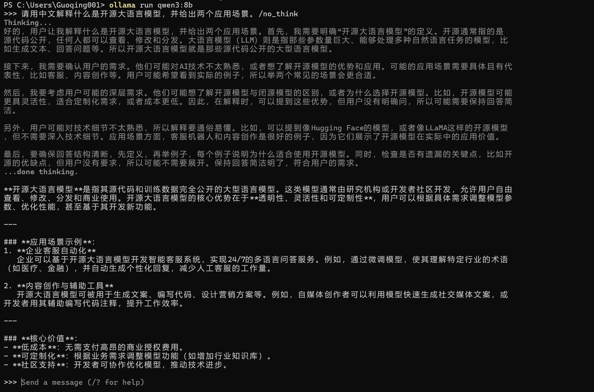
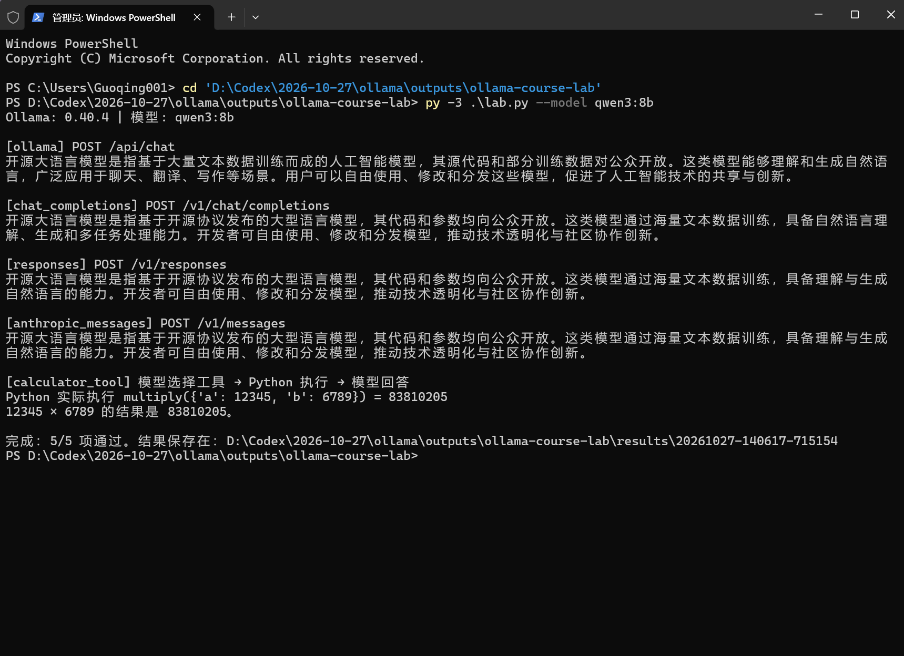
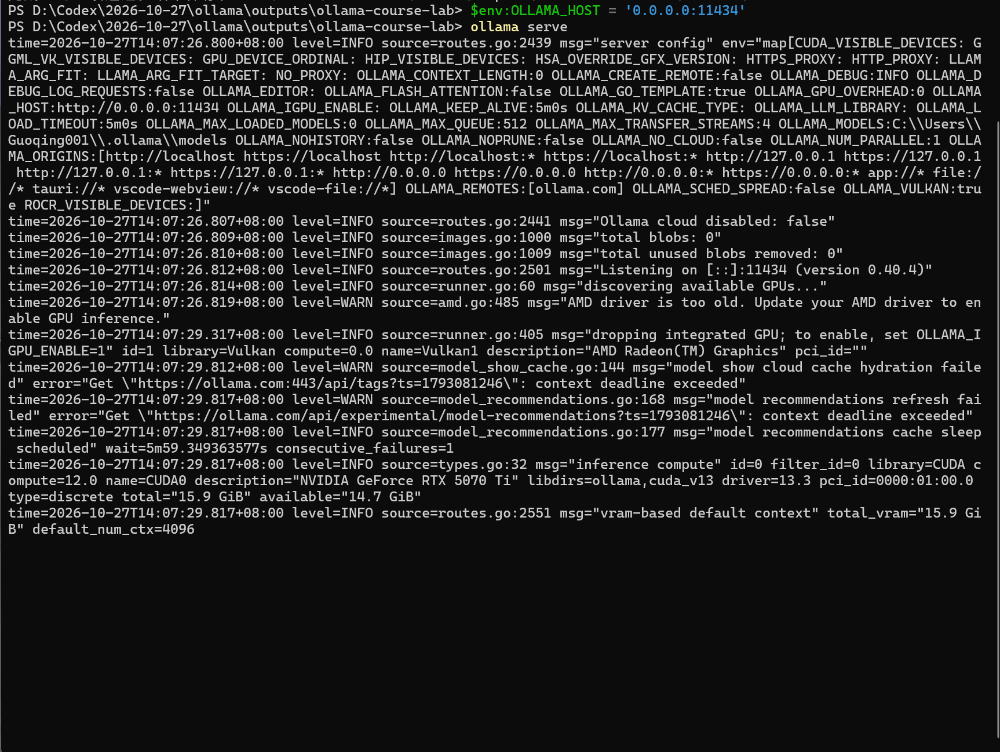
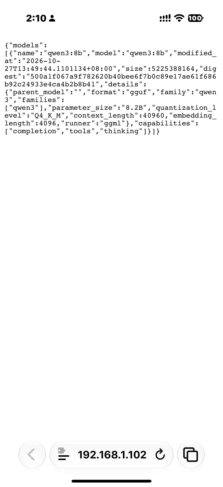

# Ollama 本地大模型部署与多接口调用实验

**姓名：郭庆　｜　学号：f25015325　｜　课程：开源课　｜　实验日期：2026 年 10 月 27 日**

本实验使用 Ollama 在 Windows 电脑上部署 Qwen3 8B，完成本地聊天、四种 HTTP API 调用对比和计算器工具调用，并通过同一局域网中的手机验证服务访问。

## 1. 实验任务与完成情况

| 任务 | 实际结果 | 对应证据 |
| --- | --- | --- |
| 模型下载与命令行调用 | `qwen3:8b` 已安装并能生成中文回答 | [本地聊天截图](screenshots/01-local-chat.png)、[环境记录](results/20261027-140617-715154/environment.json) |
| Ollama 原生 API | `/api/chat` 返回非空回答 | [原始请求与响应](results/20261027-140617-715154/ollama.json) |
| OpenAI Chat Completions 兼容接口 | `/v1/chat/completions` 返回非空回答 | [原始请求与响应](results/20261027-140617-715154/chat_completions.json) |
| OpenAI Responses 兼容接口 | `/v1/responses` 返回非空回答 | [原始请求与响应](results/20261027-140617-715154/responses.json) |
| Anthropic Messages 兼容接口 | `/v1/messages` 返回非空回答 | [原始请求与响应](results/20261027-140617-715154/anthropic_messages.json) |
| 给模型连接计算器工具 | 实际执行一次乘法函数，模型根据结果回答 | [工具调用完整记录](results/20261027-140617-715154/calculator_tool.json) |
| 局域网对外服务 | 手机成功读取电脑的模型列表 | [服务启动截图](screenshots/03-server-listening.png)、[手机访问截图](screenshots/04-phone-lan.jpg) |

自动化脚本的结果为 **5/5 项通过**，包括四种文本接口和一个工具调用实验。手机访问是单独完成的人工验证，不计入这五项。

## 2. 实验环境

| 项目 | 本次环境 |
| --- | --- |
| 操作系统与终端 | Windows、PowerShell |
| 推理服务 | Ollama `0.40.4` |
| 本地模型 | `qwen3:8b` |
| 模型参数量 / 量化格式 | 模型元数据标记 `8.2B` / `Q4_K_M` |
| 本地模型大小 | `5,225,388,164` 字节，约 5.23 GB |
| 显卡 | NVIDIA GeForce RTX 5070 Ti，约 16 GB 显存 |
| 实验脚本 | Python 3.12，全部使用标准库 |
| 本机 API 地址 | `http://127.0.0.1:11434` |
| 局域网实验地址 | `http://192.168.1.102:11434`，仅代表本次网络环境 |

模型名称、版本、量化与文件大小见 [environment.json](results/20261027-140617-715154/environment.json)。服务日志识别到了 NVIDIA CUDA 推理设备，但本实验没有单独进行 GPU 性能或稳定性测试。模型元数据中的上下文长度与运行时上下文设置属于不同层面，不应直接混用。

## 3. 模型下载与本地调用

先安装并启动 Ollama，再依次执行：

```powershell
ollama pull qwen3:8b
ollama list
ollama run qwen3:8b
```

在交互界面中输入：

```text
请用中文解释什么是开源大语言模型，并给出两个应用场景。/no_think
```

模型生成了定义说明，以及企业客服、内容创作等应用场景。输入 `/bye` 可以退出交互界面。本地聊天结果如下：



**对回答内容的核查：**截图中的“源代码和训练数据完全公开”表述过于笼统，不能作为所有开放模型的统一定义。开放权重、开放代码和开放数据的范围需要分别核查；OSI 的定义关注使用、研究、修改、分享的自由，以及修改所需的数据说明、代码和参数。模型能返回文本证明调用成功，不等于生成内容全部准确。[OSI Open Source AI Definition](https://opensource.org/ai/open-source-ai-definition)

截图中还出现了 `Thinking...`，说明本次命令行输入中的 `/no_think` 没有实现完全关闭思考输出。实验脚本在 Ollama 原生请求中显式使用 `think: false`；其他接口的原始结果可能仍含思考相关内容。因此本实验不把不同接口的耗时当作公平性能比较。

## 4. 四种 API 的调用与区别

四种调用都请求本机同一个 `qwen3:8b` 模型，区别在于接口协议、请求字段和响应结构。使用 OpenAI 或 Anthropic 兼容格式，并不意味着实际调用了 GPT 或 Claude 云端模型。

### 4.1 实验方法

脚本 [lab.py](lab.py) 通过 Python 标准库发送 HTTP 请求。各接口使用相同提示词，并设置 `stream: false`，便于保存完整 JSON：

```text
请用中文简要说明什么是开源大语言模型，限三句话。/no_think
```

运行命令：

```powershell
# 在本作业目录中运行；模型需预先下载，Ollama 服务需保持启动。
py -3 .\lab.py --model qwen3:8b
```

脚本会生成 `results/时间戳/` 目录，分别保存每种接口的请求、响应、回答、成功状态与调用耗时。本仓库保存的原始运行目录是 `20261027-140617-715154`，与下方终端截图一致。



### 4.2 输入与输出的差异

| 调用方式 | HTTP 路径 | 核心输入 | 文本输出位置 |
| --- | --- | --- | --- |
| Ollama 原生 API | `POST /api/chat` | `model`、`messages`，原生选项放在 `options` 中 | `message.content` |
| OpenAI Chat Completions | `POST /v1/chat/completions` | `model`、`messages` | `choices[0].message.content` |
| OpenAI Responses | `POST /v1/responses` | `model`、`input` | 遍历 `output` 中 `type=message` 的项，再提取 `content` 中 `type=output_text` 的文本 |
| Anthropic Messages | `POST /v1/messages` | `model`、`messages`、`max_tokens` | 遍历 `content` 中 `type=text` 的块 |

实际 JSON 样例与取值方式整理在 [四种接口的实测样例](docs/api-examples.md)。该文档取材于本次运行记录，完整返回值保留在 `results` 中。

进一步比较：

- **原生 API：**适合直接使用 Ollama 的模型参数和本地运行能力，响应还可提供加载耗时、生成 token 数等信息。[原生聊天接口](https://docs.ollama.com/api/chat)
- **Chat Completions 与 Responses：**前者围绕消息列表和 `choices` 组织结果，后者把消息、工具调用等组织为不同类型的输出项。在本次 Responses 结果中，文本前面确实有一个 `reasoning` 项，所以不能假设 `output[0]` 就是最终答案。OpenAI SDK 的 `output_text` 是便捷取值方式，原始 HTTP JSON 应按实际结构解析。[OpenAI 官方对比说明](https://developers.openai.com/api/docs/guides/migrate-to-responses)
- **Anthropic Messages：**按内容块组织文本和工具调用；系统提示使用顶层 `system` 字段。脚本使用 `anthropic-version: 2023-06-01` 和本地占位值 `x-api-key: ollama`。[Ollama 的 Anthropic 兼容说明](https://docs.ollama.com/api/anthropic-compatibility)
- **兼容范围：**Ollama 实现的是部分兼容能力。其文档说明 Responses 仅支持无状态调用，不支持 `previous_response_id` / `conversation` 管理会话；不能因为路径兼容，就认为云端内置工具和全部参数也可用。[Ollama 的 OpenAI 兼容说明](https://docs.ollama.com/api/openai-compatibility)

本次统一使用非流式、单轮文本请求。多轮、流式、视觉输入及每种协议的全部工具参数未逐项测试。

### 4.3 实际运行结果

| 接口 | 本次结果 | 单次请求耗时 |
| --- | --- | --- |
| Ollama API | PASS | 2.661 秒 |
| Chat Completions | PASS | 6.774 秒 |
| Responses | PASS | 2.000 秒 |
| Anthropic Messages | PASS | 1.990 秒 |

耗时来自原始记录的 `seconds`，包含请求、加载和推理等开销；模型缓存、思考状态与输出长度并未完全控制，因此仅用于记录本次运行，不据此给接口做性能排名。

## 5. 模型对外服务与手机验证

### 5.1 服务启动

退出已有的 Ollama 托盘进程，避免端口重复占用，再在 PowerShell 中执行：

```powershell
$env:OLLAMA_HOST = '0.0.0.0:11434'
ollama serve
```

`0.0.0.0` 用于监听本机各网络接口，客户端访问时应填写服务器的实际 IP。该窗口需要保持开启。服务日志显示 `Listening on [::]:11434`，随后识别到了 NVIDIA RTX 5070 Ti：



本机局域网 IPv4 地址为 `192.168.1.102`。手机连接同一 Wi-Fi，访问：

```text
http://192.168.1.102:11434/api/tags
```

### 5.2 手机访问结果

手机页面成功返回 `models` 列表，其中包含 `qwen3:8b`、模型大小、`8.2B` 参数量和 `Q4_K_M` 量化信息，证明服务可被同一局域网中的其他设备访问。



[查看手机截图原图](screenshots/04-phone-lan.jpg)

**验证范围：**已完成本机推理调用和手机远程读取模型列表；未记录手机发送生成请求并收到答案的测试，也未部署公网服务。本次局域网地址只用于实验复现说明，不是作业提交链接。

本地 Ollama API 默认没有身份验证，本实验在可信局域网内临时开放。演示结束后可用 `Ctrl+C` 停止当前服务，执行 `Remove-Item Env:OLLAMA_HOST`，再按默认方式启动 Ollama。[官方服务与网络配置](https://docs.ollama.com/faq)

## 6. 给模型增加“外挂”：计算器工具

### 6.1 实现原理

本实验通过 Ollama 的工具调用能力连接一个 Python 乘法函数。程序先向模型声明工具名 `multiply` 和参数 `a`、`b`；模型选择工具并给出参数后，Python 执行函数，再以 `role=tool` 的消息把结果回传给模型。[Ollama 工具调用说明](https://docs.ollama.com/capabilities/tool-calling)

```text
用户提出计算问题
    ↓
模型输出 multiply(a=12345, b=6789) 工具调用
    ↓
Python 执行乘法，得到 83810205
    ↓
程序将工具结果传回模型
    ↓
模型回答：12345 × 6789 的结果是 83810205。
```

模型输出的是工具调用请求；实际运算由 Python 完成。程序只允许调用预先定义的 `multiply`，使用 `Decimal` 处理数值，不执行模型生成的任意代码。

### 6.2 真实调用记录

[calculator_tool.json](results/20261027-140617-715154/calculator_tool.json) 保存了完整的两轮请求与响应：

| 阶段 | 本次记录 |
| --- | --- |
| 模型选择工具 | `tool_calls[0].function.name = multiply` |
| 参数 | `a = 12345`、`b = 6789` |
| Python 执行结果 | `83810205` |
| 结果回传 | `role = tool`、`tool_name = multiply` |
| 最终回答 | `12345 × 6789 的结果是 83810205。` |
| 实际工具调用次数 | `1` |

这验证了“模型提出调用 → 程序执行 → 结果回传 → 模型回答”的完整过程。

### 6.3 还可以接什么外挂

| 扩展方向 | 如何接入、解决什么问题 | 本次状态 |
| --- | --- | --- |
| 计算器、自定义函数 | 模型给出参数，程序执行确定性运算或业务逻辑 | 已实现乘法工具 |
| 知识库 / RAG | 检索课程文档中的相关片段，再把内容提供给模型回答 | 方案说明，未实现 |
| 搜索、天气等外部 API | 由程序调用外部服务，给模型补充实时信息 | 方案说明，未实现 |
| 数据库 | 通过受控查询读取结构化数据，例如课程表或库存 | 方案说明，未实现 |
| MCP 工具接入 | 支持 MCP 的客户端连接工具服务器，再把工具能力交给模型使用 | 方案说明，未实现 |

这些能力需要应用或工具层配合。模型本身能够生成文本，不代表它自动拥有实时信息、数据库权限或外部执行能力。RAG 是通过检索补充上下文，也不等同于重新训练模型。

## 7. 问题分析与实验收获

1. **下载域名被解析为 Fake-IP。**最初下载时出现 `resolves to non-public 198.18.0.81`，检查发现代理参与了 DNS 解析。排查后模型下载成功。复现此类问题时应检查代理、DNS 与实际解析结果，不应只反复重试相同命令。
2. **接口通了还要核查语义。**四种接口均返回回答，但生成内容中存在对开放范围的概括偏差；必须把“调用成功”和“回答准确”分开评价。
3. **响应解析不能写死第一项。**Responses 的首个输出可能是思考相关项，Anthropic 也可能含多种内容块，应按类型筛选文本。
4. **对外服务需要客户端证据。**监听端口只说明服务启动，手机实际读取到模型列表才补齐了局域网可访问的证据。
5. **工具调用扩展了模型的处理能力。**本实验让程序执行精确计算，再交给模型组织答案，展示了模型与外部工具协作的方式。

## 8. 文件说明与复现

```text
ollama-homework/
├── README.md                 本实验报告
├── lab.py                    可运行实验代码，无第三方 Python 依赖
├── docs/
│   └── api-examples.md        从实际记录整理的四种接口样例
├── results/
│   └── 20261027-140617-715154/
│       ├── environment.json
│       ├── ollama.json
│       ├── chat_completions.json
│       ├── responses.json
│       ├── anthropic_messages.json
│       ├── calculator_tool.json
│       └── 实验结果.md
└── screenshots/
    ├── 01-local-chat.png
    ├── 02-api-and-tool-pass.png
    ├── 03-server-listening.png
    └── 04-phone-lan.jpg
```

复现时先安装 Ollama 与 Python 3.10 或以上版本，执行 `ollama pull qwen3:8b` 并保持服务运行，然后进入本目录执行 `py -3 .\lab.py --model qwen3:8b`。Linux/macOS 可使用 `python3 lab.py --model qwen3:8b`。若只测试四种接口，可附加 `--skip-tools`；首次加载较慢时可附加 `--timeout 300`。

原始 JSON、自动生成的《实验结果》和四张截图保持原样，报告与样例文档是基于这些证据整理的说明。仓库不包含模型权重或 Python 虚拟环境。
